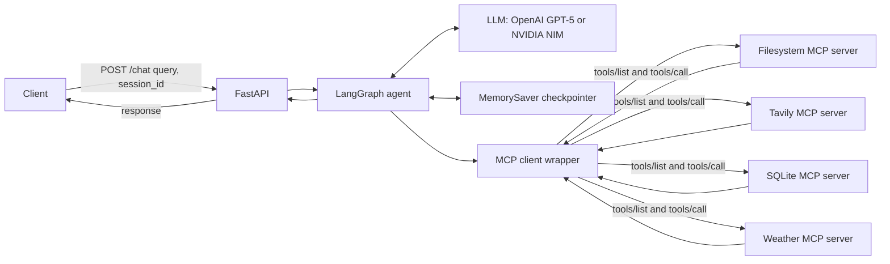
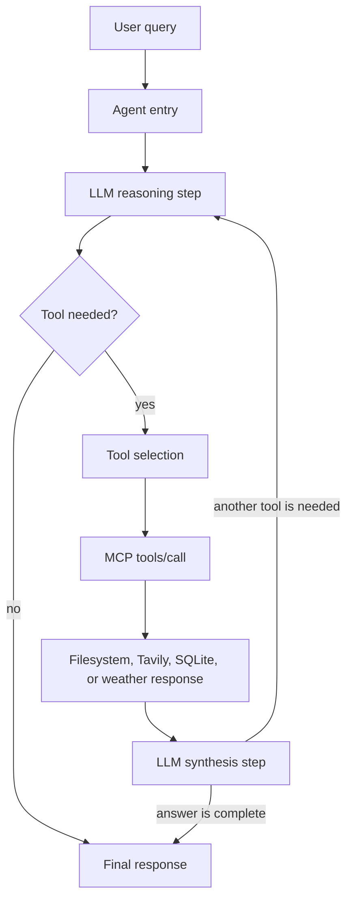
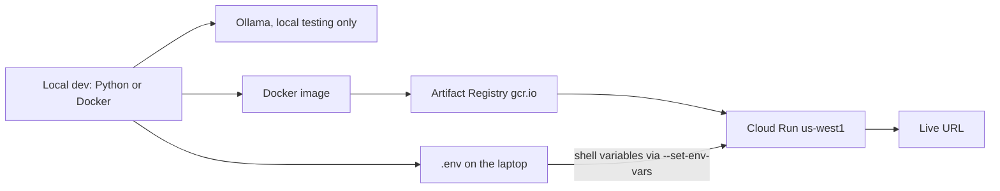

# Research Notebook Agent

A research notebook for CSCI 599 Assignment 1. It is not a general chatbot. `POST /chat` does six things: explain a concept from knowledge, search the web, save a markdown note, catalog the source in SQLite, look up the current weather, and remember the session.

A request to find something and keep it searches, writes the note, and inserts a catalog row before it answers. A definition, or a question about the conversation, uses no tool. The `session_id` keeps that notebook thread while the Cloud Run instance is running.

## MCP servers

| Server | Package | What it is for |
|---|---|---|
| filesystem | [`@modelcontextprotocol/server-filesystem`](https://github.com/modelcontextprotocol/servers) | Read and write notes under `notes/` |
| tavily | [`tavily-mcp`](https://github.com/tavily-ai/tavily-mcp) | Web search for papers, docs, and current facts |
| sqlite | [`mcp-server-sqlite`](https://github.com/modelcontextprotocol/servers-archived/tree/main/src/sqlite) | Query and update the `sources` table |
| weather | [`weather-open-meteo-mcp`](https://github.com/adrianR84/Weather-Open-Meteo-MCP) | Current hourly and daily forecasts from Open-Meteo |

Filesystem and Tavily are the two required servers. SQLite is the additional catalog server: notes are the pages a person reads, and the database is the list of sources the agent can filter later. Weather is a second additional server. A forecast is a different `tools/call` from web search, and Open-Meteo does not need an API key. The assignment names `@modelcontextprotocol/server-sqlite` on npm. That package is not published. The official server from the Model Context Protocol project is the Python package `mcp-server-sqlite`, launched as `mcp-server-sqlite --db-path <file>`. This project uses that server.

Discovery and calls go through `langchain-mcp-adapters` (`tools/list` and `tools/call`). Tool results are not hard-coded. If a server is down, a tool returns an error, or a payload cannot be read, the wrapper turns that into a tool message and the HTTP handler still returns JSON.

## Cost

- **LLM.** Default is NVIDIA NIM through `ChatNVIDIA`, model `nvidia/nemotron-3.5-lightning-30b-a3b`. Put the key in `NVIDIA_API_KEY` inside `.env`. The free tier is about 40 requests per minute. OpenAI `gpt-5` is used only when `NVIDIA_API_KEY` is unset and `OPENAI_API_KEY` is set.
- **Tavily.** The coursework free tier is enough. The Project Plan includes 4,000 credits per month.
- **Filesystem and SQLite.** No external API cost.
- **Weather.** Open-Meteo through `weather-open-meteo-mcp@0.1.2`. No API key. The non-commercial forecast API is free.
- **Cloud Run.** `us-west1`, 512Mi, minimum 0 instances, maximum 1 instance. Scale-to-zero keeps idle cost near zero. Last semester's reference for three Cloud Run projects was under $10 of the $50 education credit.

Ollama is for local experiments only. Do not deploy it. The live service must use OpenAI or NIM.

## Layout

```text
main.py            FastAPI, PORT, POST /chat
agent.py           LangGraph agent and MemorySaver
mcp_client.py      MCP discovery, tools/call, failure wrapper
mcp_config.json    server commands
config_loader.py   paths, schema, manifest
Dockerfile         python:3.13-slim, Node, non-root user
deploy.sh          Cloud Run deploy
```

## Setup

Python 3.13 matches the container. `mcp-server-sqlite` requires Python 3.10 or newer. Node.js 18 or newer is required for the filesystem, Tavily, and weather servers.

```bash
python -m venv .venv
```

Windows PowerShell:

```powershell
.\.venv\Scripts\Activate.ps1
pip install -r requirements.txt
Copy-Item .env.example .env
```

macOS or Linux:

```bash
source .venv/bin/activate
pip install -r requirements.txt
cp .env.example .env
```

Edit `.env`. Never commit it.

```text
NVIDIA_API_KEY=...
NVIDIA_MODEL=nvidia/nemotron-3.5-lightning-30b-a3b
TAVILY_API_KEY=...
GCP_PROJECT_ID=...
```

## Run locally

```bash
python main.py
```

The process reads `PORT` and defaults to 8080. It listens on `0.0.0.0`.

```bash
curl -s http://127.0.0.1:8080/chat \
  -H "Content-Type: application/json" \
  -d "{\"query\": \"What is an MCP server?\", \"session_id\": \"demo-1\"}"
```

Use the same `session_id` for a follow-up such as "What did I just ask you?". A different `session_id` has its own history. Memory is LangGraph `MemorySaver` (the in-memory checkpointer; current LangGraph also exports it as `InMemorySaver`). It lasts for the life of the process. A restart clears it. That matches the assignment: durable storage across Cloud Run instance replacement is not required.

`GET /health` lists the tools discovered at startup and any server that failed to launch.

### Checks worth running

- "What is the Model Context Protocol?" should answer with no tool.
- "Search for recent writing on tool-using agents." should call Tavily.
- "What is the weather in Los Angeles today?" should call the weather server, not Tavily.
- "Save that summary to notes/agents.md", same `session_id`, should write a file.
- "Record that source in the catalog" should insert a `sources` row.
- "Search for LangGraph checkpointers, save a note, and record the source" should chain search, then a file write, then a SQL insert.
- Stop the filesystem server, or ask for a missing file, and confirm the response explains the failure instead of a stack trace.

Unit checks that do not call the model:

```bash
python -m unittest discover -s tests
```

## Docker

```bash
docker build -t csci599-a1 .
docker run --env-file .env -e PORT=8080 -p 8080:8080 csci599-a1
```

The image installs Node, the npm MCP servers (filesystem, Tavily, and weather), and `mcp-server-sqlite`. The final stage runs as `appuser`.

## Deploy

Use the Gmail account that holds the $50 education credit. USC `@usc.edu` accounts cannot create the project.

```bash
gcloud auth login
gcloud config set project YOUR_PROJECT_ID
gcloud services enable run.googleapis.com cloudbuild.googleapis.com
```

From Git Bash or WSL, in this directory:

```bash
bash deploy.sh
```

The script sources `.env` and passes the variables to Cloud Run with `--set-env-vars`. Keys are not written into the script. Region is `us-west1`, memory is 512Mi, `--min-instances 0`, `--max-instances 1`. One instance keeps `MemorySaver` on a single process. After a cold start the conversation is empty again.

Submit the printed URL, for example `https://csci599-a1-xxxxxxxxxx-uw.a.run.app`. Leave the service deployed until grades are posted.

## Diagrams

### 1. System architecture



### 2. Tool invocation flow



The arrow from synthesis back to reasoning is the multi-step loop. Search, then save a note, goes through the model again instead of stopping after the first tool.

### 3. Deployment topology



Local runs read `.env` through `python-dotenv`. `deploy.sh` sources the same file and passes `OPENAI_API_KEY`, `OPENAI_MODEL`, `TAVILY_API_KEY`, and the MCP paths to Cloud Run. The live service uses the cloud LLM, not Ollama.

## Request contract

```http
POST /chat
{"query": "string", "session_id": "string"}
```

```json
{"response": "string"}
```

A blank `query` or `session_id` returns a validation error. Any other failure that escapes the tool loop is caught and returned as `{"response": "..."}`.
